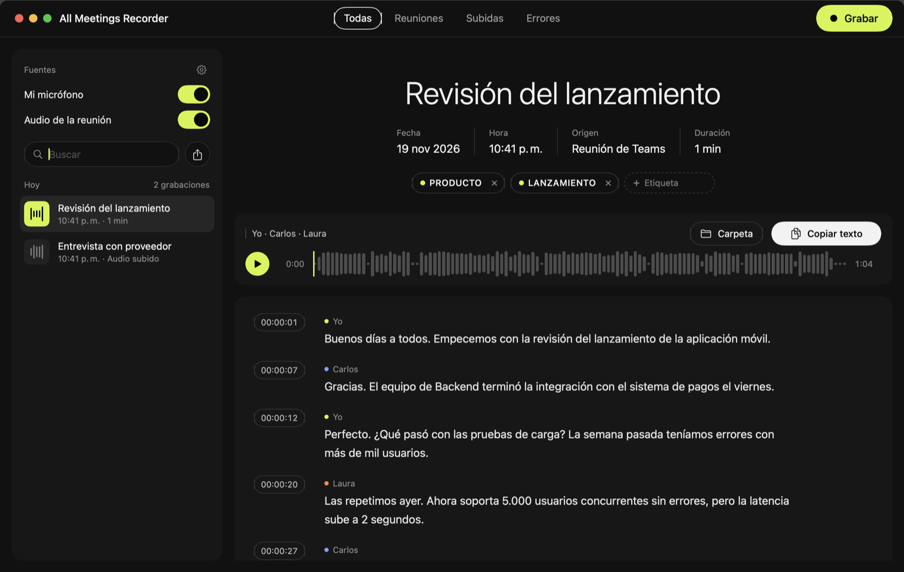
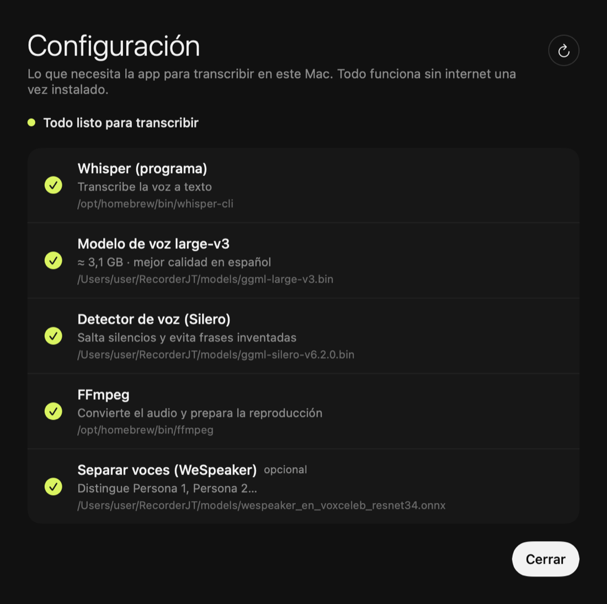

# All Meetings Recorder

Grabadora de reuniones para macOS. Graba el audio de **Teams, Zoom o Meet** junto con tu micrófono y lo transcribe **en tu propio Mac** con Whisper. También separa las voces (Persona 1, Persona 2…), detecta cuándo hablan dos a la vez y **recuerda las voces**: cuando le pones nombre a alguien, en las reuniones siguientes aparece ya con su nombre.

- **Privado:** el audio nunca sale del Mac. No hace falta internet ni cuentas.
- **Gratis:** no usa APIs de pago. El resumen con IA es opcional y sólo se hace si lo pides.
- **Mientras grabas:** transcribe por bloques de 5 minutos, así el texto está listo casi al terminar.
- **Español, inglés o ambos:** en *Idioma*, *Auto* detecta el idioma cada pocos minutos, así que sirve para reuniones que cambian de idioma o mezclan los dos.
- **También sube audios** (m4a, mp3, wav, notas de voz de WhatsApp, vídeos…) para transcribirlos.



<p align="center"></p>
<p align="center"><sub>Configuración: muestra qué falta e instala o descarga con un clic.</sub></p>

## Requisitos

| | Mínimo | Recomendado |
|---|---|---|
| Mac | Apple Silicon (M1 o más nuevo) | M1 Pro/Max, M2 Pro o más nuevo |
| macOS | **14.4 Sonoma** (necesario para grabar el audio de las reuniones) | 15 o más nuevo |
| Memoria | 8 GB (con el modelo rápido) | 16 GB |
| Disco | 6 GB libres (modelo de voz + grabaciones) | 20 GB |

Además necesitas [Homebrew](https://brew.sh/es/) y las herramientas de línea de comandos de Xcode (el instalador las pide si faltan).

Si el Mac es un Intel, la app funciona, pero transcribe muy despacio.

## Instalación

```bash
git clone https://github.com/juliotoribio/all_meetings_recorder.git
cd all_meetings_recorder
./install.sh
```

El instalador:

1. Comprueba el Mac.
2. Instala whisper, ffmpeg y uv con Homebrew.
3. Prepara el worker de Python.
4. Compila la app y la deja en `~/Applications/All Meetings Recorder.app`.

Luego, en la app, abre **Configuración** (⚙️ junto a *Fuentes*, o `⌘,`) y descarga un modelo de voz. Basta con uno:

| Modelo | Tamaño | Velocidad (M1 Max) | Para |
|---|---|---|---|
| **Calidad máxima** (large-v3) | ≈ 3,1 GB | ~9× tiempo real | Reuniones difíciles: ruido, acentos, nombres, spanglish |
| **Rápido** (large-v3-turbo) | 574 MB | ~20× tiempo real | Macs de 8 GB, poco disco o cuando importa la rapidez |

Si tienes los dos, eliges en *Calidad* (Máxima o Rápida) antes de grabar o subir un audio. El instalador también puede descargarlos: `./install.sh --models` (calidad máxima) o `./install.sh --models-fast` (rápido).

La primera vez, macOS pedirá dos permisos:

- **Micrófono.**
- **Grabación de audio del sistema**, que es la que permite captar el audio de la reunión.

> La app se compila en tu Mac, así que no hace falta firmarla con Apple. Si mueves la carpeta del repo, vuelve a ejecutar `./install.sh`.

## Uso

- **Grabar:** usa el botón *Grabar*, que también está en el icono de la barra de menú. Con *Fuentes* eliges qué captar: tu micrófono, el audio de la reunión o ambos.
- **Subir audio:** arrastra un archivo a la ventana o usa el botón de subir.
- **Renombrar o borrar:** pasa el ratón por una grabación del historial. Lo que borras va a la Papelera.
- **Nombrar voces:** haz clic en *Persona 1* en la transcripción y escribe su nombre.
- **Copiar texto:** copia la transcripción completa para pegarla donde quieras.

Las grabaciones se guardan en `~/RecorderJT/sessions/`.

## Resumen con IA (opcional)

Por defecto sólo se transcribe. Para resumir una sesión, elige un proveedor:

```bash
worker/.venv/bin/recorder resume --provider local      # última sesión, con LM Studio en tu Mac (gratis, privado)
worker/.venv/bin/recorder set-key deepseek             # o claude: guarda tu API key
worker/.venv/bin/recorder resume --provider deepseek   # el resumen queda copiado en el portapapeles
```

Las API keys se guardan en el Llavero de macOS. Con `deepseek` o `claude`, la transcripción (no el audio) se envía a ese servicio.

## Configuración avanzada

`config/config.toml` contiene:

- El idioma.
- El glosario de nombres y siglas, que ayuda a la ortografía.
- Las rutas de los modelos.
- Los proveedores de resumen.

Para tener un ajuste propio sin tocar el repo, copia ese archivo a `~/RecorderJT/config.toml`: si existe, se usa ese.

Para comprobar que todo está instalado:

```bash
worker/.venv/bin/recorder doctor
```

## Desinstalar

```bash
rm -rf "$HOME/Applications/All Meetings Recorder.app"
rm -rf ~/RecorderJT   # ⚠️ borra también las grabaciones y los modelos
```

## Aviso legal

En muchos países es obligatorio avisar a las personas antes de grabarlas. Hacerlo es responsabilidad de quien usa la app.

## Licencia

El código de este repositorio es [MIT](LICENSE).

## Componentes de terceros

| Componente | Licencia |
|---|---|
| [whisper.cpp](https://github.com/ggml-org/whisper.cpp) y los modelos Whisper | MIT |
| [Silero VAD](https://github.com/snakers4/silero-vad) | MIT |
| [pyannote segmentation-3.0](https://huggingface.co/pyannote/segmentation-3.0) (ONNX de sherpa-onnx) | MIT |
| [sherpa-onnx](https://github.com/k2-fsa/sherpa-onnx) | Apache 2.0 |
| Modelo de voces [WeSpeaker](https://github.com/wenet-e2e/wespeaker) (ResNet34, VoxCeleb) | revisa su licencia antes de un uso comercial |
| [FFmpeg](https://ffmpeg.org) | LGPL/GPL |

Ninguno se incluye en este repositorio: Homebrew instala los programas y los modelos se descargan de sus fuentes oficiales.
